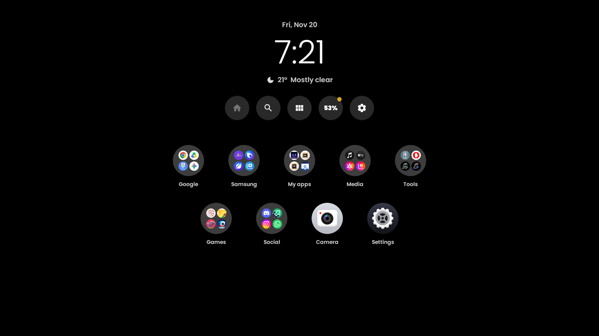
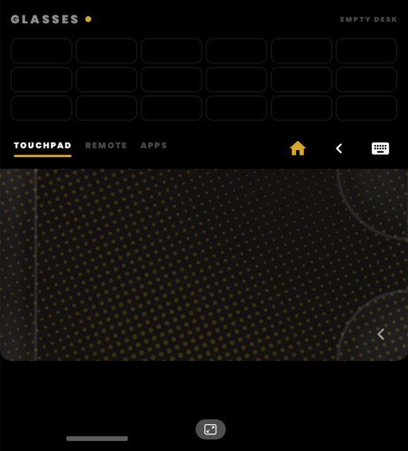
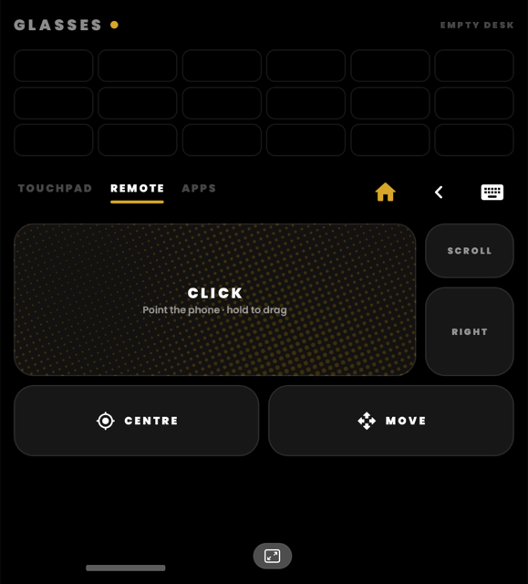
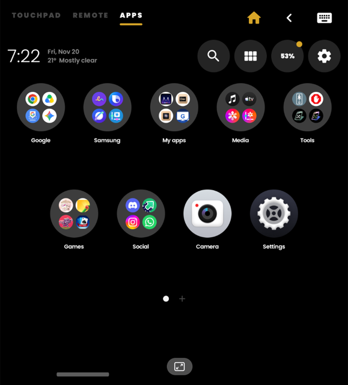
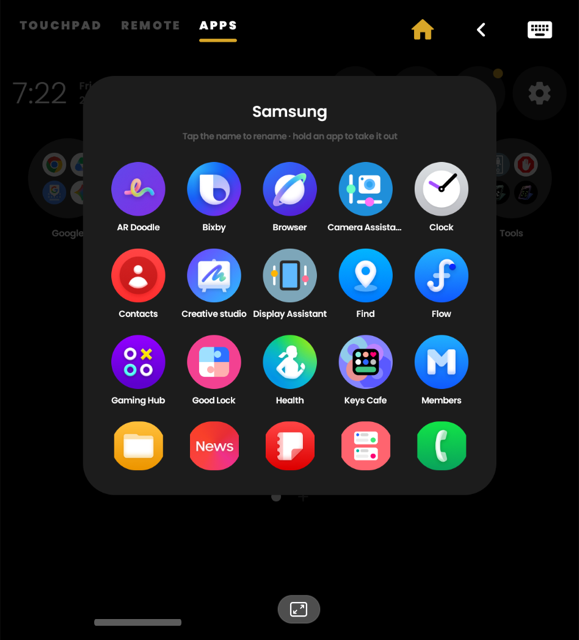

# SuperAir

**An AR desktop for Xreal glasses, run from a folded Galaxy Z Flip 7.**

Your apps float in the air on a six-by-three grid. The phone stays shut in your hand and works as
the trackpad, the air mouse, the keyboard and the window manager.



The background is black, and that is the whole design. The optics are additive, so a black pixel
gives off no light and the room shows through it. SuperAir never draws a backdrop. It draws apps,
and everything else is the world.

## The cover screen

| Touchpad | Remote | Apps | A folder |
|:---:|:---:|:---:|:---:|
|  |  |  |  |

### The desk, in miniature

The strip at the top is a live picture of the grid on the glasses. Gestures there arrange the
apps:

| Gesture | What it does |
|---|---|
| Tap an app | Focus it |
| Double-tap an app | Fullscreen on the glasses, and back |
| Drag an app | Move it to other cells |
| Hold, then drag | Resize it: the top-left corner stays, your finger is the far corner |
| Drag it off the edge | Close it |
| Tap an empty cell | Open Home |

A new app opens two cells wide and three tall, so three fit side by side. Each app runs on its own
display, at the true pixel size of its cells, so text stays sharp at every shape.

### Touchpad

- One finger moves the cursor and a tap clicks.
- Two fingers scroll, and a two-finger tap is a right click.
- **The rail** down the left edge scrolls with your thumb.
- **The top-right corner** is a mouse button you can hold. Keep it down and move with another
  finger to drag.
- **The bottom-right corner** goes back.
- The cursor fades after three seconds of rest.

The rail and both corners turn off the system's back swipe, so sweeping the rail never takes you
back by mistake.

### Remote

An air mouse: point the phone and the cursor follows. **Click** (hold to drag), **Scroll**,
**Right**, **Centre** and **Move**.

### Apps

Home on the cover: the same folders, pages, search and settings as on the glasses. The row above
every tab also has Home, Back and the keyboard.

## Home

Home appears on the glasses and on the cover together. It shows:

- the date, the time and the weather;
- a tool row with **Desk**, **Search**, **Sort**, **battery** and **Settings**;
- your apps in folders, laid out like Android XR.

The folders start as Google, Samsung, My apps, Media and Tools. You can rename them, and you can
hold an app to take it out of one.

**Battery** shows the charge, turns gold while charging and has a dot when something is waiting.
Tap it for the phone's notifications. Tap one to open its app on the glasses, dismiss it with the ×,
or clear them all.

## Locking

Press the power key and the cover goes dark, but every app on the glasses keeps running. While the
cover is dark it ignores touch completely, so the phone can't wake itself up in a pocket. Press the
power key again, unlock, and the cover comes back where you left it.

To make that possible, SuperAir keeps USB in charging mode. One UI's default switches USB to file
transfer at every unlock and back at every lock, and each switch restarts adbd, which would take
SuperAir's host and every app on the glasses with it. File transfer still works when you pick it
from the USB notification.

## What it needs

- **A Galaxy Z Flip 7.** It is verified on Android 17 with One UI 8.5. Other Android 13+ phones
  whose USB-C port carries DisplayPort should work, but the cover screen layout is made for the
  Flip.
- **Xreal glasses,** or any glasses that take DisplayPort over USB-C.
- **Wireless debugging,** paired once, on the phone itself. Only the shell user may create a display
  that holds another app's windows, so there is no reduced mode without it.

## Setting up

1. Install the APK from the [latest release](https://github.com/RimorCosmicam/SuperAir/releases/latest), open SuperAir, and turn it on in Accessibility when asked. It only uses this to
   float the pairing bar.
2. Press **Pair with floating bar**. SuperAir opens Developer options with a bar floating above it.
   - Open Wireless debugging and tap "Pair device with pairing code".
   - Type the six digits into the bar.

   Settings throws its code away the moment you leave its screen, which is why the bar floats over
   it instead of being a dialog in SuperAir.
3. **Add SuperAir to the cover screen apps** in Good Lock → MultiStar. Without that, One UI fits
   SuperAir into the top of the cover and puts its own expand bar underneath.
4. Plug in the glasses.

From then on SuperAir starts its host by itself, with no computer involved.

## Building

```bash
./gradlew assembleDebug
```

One APK holds both halves: the app, and the shell-side host compiled into the same artifact.
Nothing is copied to `/data/local/tmp`. `app_process` is handed the APK's own installed path, so
there is one thing to install and no writable copy of SuperAir's code on the device.

A release build signs itself with the key named in `keystore.properties` at the project root
(`storeFile`, `storePassword`, `keyAlias`, `keyPassword`). That file is never committed. Without
it, `./gradlew assembleRelease` makes an unsigned APK.

With a computer attached over adb, this builds, installs and starts the host:

```bash
scripts/deploy.sh
```

## How it works

Three parties on one phone:

| Process | Runs as | Does |
|---|---|---|
| `server/` | shell (uid 2000) | Makes the displays, launches apps onto them, injects input, watches the power key |
| `app/` | ordinary app | Draws the scene on the glasses, and the controls on the cover |
| Android | — | Knows nothing about any of it |

**One display per app.** Every app gets its own trusted virtual display, and that display draws
into a `SurfaceView` in SuperAir's scene on the glasses. Both ends are on the same phone, so there
is no encoder, no decoder and no network in the path: SurfaceFlinger composites the apps straight
onto the glasses.

**Resizing is a real resize.** An app's cells become its display's pixel size, so the app lays
itself out again at exactly the size it fills. Nothing is ever scaled.

**The binder is the trick.** Only uid 2000 may create a trusted display, and only a trusted display
will host another app's windows. A `Surface` can't be sent down a socket, because only a binder
transaction carries one. So the shell host reaches into the app's own `ContentProvider` and leaves
its binder there, which is the mechanism Shizuku has used for years. See `BridgeProvider.kt` and
`server/Bridge.java`.

**The power key belongs to the host.** It reads the key from the input device, darkens the cover
by setting its panel's power mode, and locks the phone, while the glasses keep their own display
awake.

[`docs/MEASUREMENTS.md`](docs/MEASUREMENTS.md) records what was measured on the phone to get here,
and what is still a guess.

## Development without the glasses

The host can make a 1920×1080 stand-in display and put the scene there, so you can watch it with
`scrcpy --display-id=<id>` with nothing plugged in. It is off by default, because a display nobody
sees still costs power.

## Known conflicts

**TheHud, and anything else that claims a display.** TheHud puts its own presentation on any
display past the phone's own two, so with both installed they fight over the glasses. Stop one
before running the other.

SuperAir only ever takes a display whose type is `EXTERNAL`, so it ignores other projects'
virtual displays.

## Credits

Built on three earlier projects of its own family:

- **miniMont** — the shell-uid display host and a `docs/` that says plainly which guesses were
  measured.
- **Kamui Desktop** — the per-app display, launches that land where they were sent, the parked
  surface and input injection.
- **TheHud** — finding the glasses among the phone's screens, the cover-screen design, and its
  touchpad: the gesture recognizer, acceleration curve, filtering and momentum scrolling.

Weather comes from [Open-Meteo](https://open-meteo.com/).

## License

SuperAir is free software under the [GNU General Public License v3.0](LICENSE).

The typeface is [Poppins](https://github.com/itfoundry/Poppins), under the
[SIL Open Font License 1.1](licenses/Poppins-OFL.txt).
